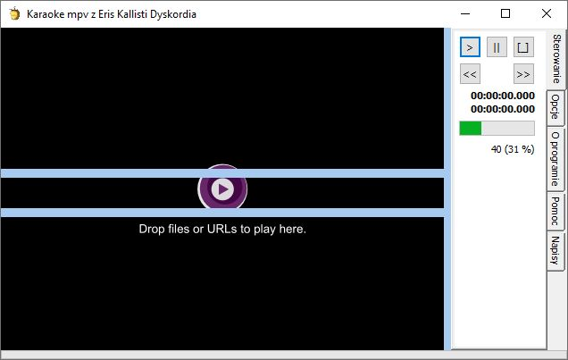
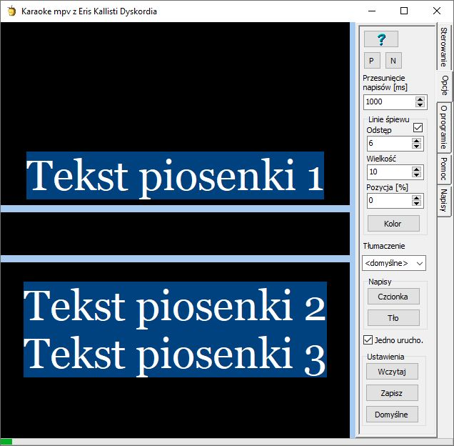
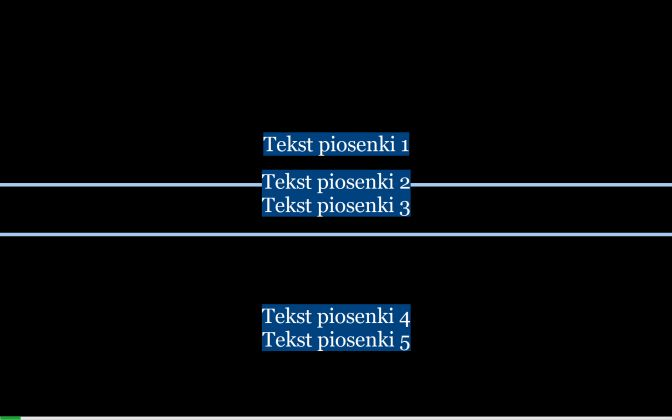

# Karaoke-Mpv-z-Eris-Kallisti-Dyskordia

Odtwarzacz multimedialny wyświetlający napisy do karaoke w formie przesuwającego się tekstu. Program zawiera tłumaczenia na kilka wersji językowych.

Program został stworzony w Delphi z użyciem komponentów projektu [LibMPVDelphi](https://github.com/nbuyer/LibMPVDelphi).
Aby program mógł działać potrzebny jest plik [libmpv-2.dll](https://sourceforge.net/projects/mpv-player-windows/files/libmpv/).

Wersja x32 nie działa.

## English

A media player created in Delphi that displays karaoke subtitles in the form of moving text. The program includes translations into several language versions.

The program uses [LibMPVDelphi](https://github.com/nbuyer/LibMPVDelphi).
To run the program requires an '[libmpv-2.dll](https://sourceforge.net/projects/mpv-player-windows/files/libmpv/)' file.

The x32 version does not work.

Powered by

[LibMPVDelphi](https://github.com/nbuyer/LibMPVDelphi),

[mpv](https://mpv.io/),

[Delphi](https://www.embarcadero.com/products/delphi).

## Tag
darmowy odtwarzacz karaoke PC Windows darmowe karaoke

free player karaoke PC Windows free karaoke
